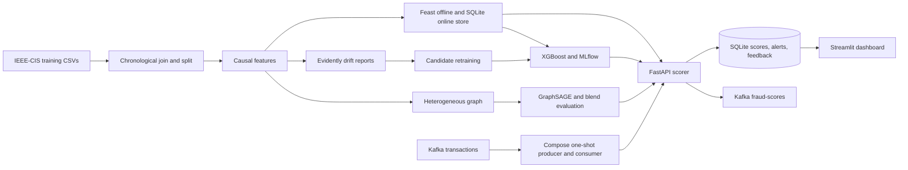

# Real-Time Financial Fraud Detection Platform

This project is a reproducible prototype for identifying potentially fraudulent payment transactions under severe class imbalance. It prepares chronological IEEE-CIS training data, builds causal per-identity features, compares XGBoost with GraphSAGE, and provides an API, Kafka replay/consumer, analyst dashboard, and drift-triggered candidate retraining flow. The saved metrics and tests are offline evaluation; the Docker Compose and Kubernetes runtimes still need the user's one-time verification.

## One-click demo

On the configured Windows laptop, start Docker Desktop and double-click **`START_DEMO.bat`**. The launcher checks Docker and the required ports, builds only missing project images, starts Compose, resets the serving database for a predictable run, creates Kafka topics, replays test transactions, waits for scoring, and opens the dashboard. It logs to `demo_logs/`. Use **`CHECK_DEMO.bat`** for PASS/FAIL checks and **`STOP_DEMO.bat`** to stop containers while preserving images and named data volumes.

The one-click path requires generated local inputs: processed features, a materialized Feast SQLite store, exported XGBoost artifacts, and GNN score/ring artifacts. These are ignored by Git. On a fresh clone, download the permitted Kaggle files and complete the build steps below first. Runtime has not been executed in this sandbox; see [one-time verification steps](docs/VERIFY_ONCE.md).

## Architecture



## Saved results

Metrics below were extracted directly from the named `results/*.json` files. PR-AUC should be interpreted against each split's fraud base rate. Fraud prevalence differs by split: **1.72% validation versus 3.67% test**, so validation and test PR-AUC are not like-for-like comparisons.

| Result | Validation | Test / value | Source |
|---|---:|---:|---|
| Fraud base rate | 1.72% | 3.67% | `results/xgb_metrics.json` |
| Random ranking PR-AUC | 0.01720 | 0.03667 | `results/xgb_metrics.json` |
| Logistic regression PR-AUC | 0.08321 | 0.15682 | `results/xgb_metrics.json` |
| XGBoost unweighted PR-AUC | 0.41722 | 0.55306 | `results/xgb_metrics.json` |
| XGBoost weighted PR-AUC | 0.34607 | 0.50755 | `results/xgb_metrics.json` |
| GraphSAGE, real edges PR-AUC | 0.15886 | 0.27174 | `results/ablation.json` |
| GraphSAGE, shuffled edges PR-AUC | 0.14072 | 0.26350 | `results/ablation.json` |
| Blend PR-AUC; XGBoost weight 1.0 | 0.41722 | 0.55306 | `results/ablation.json` |
| Online scorer latency (excludes Kafka/startup) | — | p50 26.28 ms; p95 52.14 ms; p99 74.36 ms; throughput 33.01 tx/s | `results/latency.json` |
| Feast historical/online parity | — | 67/67 fields equal for 100 sampled transactions | `results/feature_parity.json` |
| Natural-window drift threshold | — | 0.60; natural maximum 0.50 | `results/drift/natural_baseline.json` |
| Candidate versus champion test PR-AUC | — | candidate 0.59838; champion 0.55306 | `results/retrain_log.json` |
| Fraud rate inside/outside multi-transaction rings | — | 49.05% inside; 59.11% outside | `results/ring_precision.json` |
| Strong-link / weak-link-containing ring fraud rate | — | 62.14% strong-only; 46.61% includes weak links | `results/ring_precision.json` |

The serving threshold is selected from the validation top-3% alert boundary; applying a fixed cutoff to test does not guarantee a 3% alert rate. Candidate-vs-champion numbers are a final test comparison only, not an unbiased estimate of future performance.

## Fresh-clone setup and training

Run the project commands from WSL2 Ubuntu with the repository under the Linux home directory, not `/mnt/c`:

```bash
uv python install 3.11
make setup
.venv/bin/python --version
```

Download `train_transaction.csv` and `train_identity.csv` from the [IEEE-CIS Kaggle data page](https://www.kaggle.com/competitions/ieee-fraud-detection/data) after accepting the competition's rules. Put those training files in `data/raw/`. Do not use Kaggle test files. Kaggle data and all generated datasets/artifacts are not tracked.

Run the generation jobs in order:

```bash
make data
make feature-store
make train-xgb-local
make export-model
make train-gnn-local
make drift
make retrain-local RETRAIN_ARGS="--dry-run"
```

`make feature-store` rebuilds the features, applies the Feast repository, materializes the SQLite online store and runs the parity check. Training and deployment require these generated files; a fresh clone cannot skip them.

## Manual demo commands

The batch file is the intended launch path. For troubleshooting from WSL2:

```bash
./scripts/demo_start.sh
./scripts/demo_check.sh
./scripts/demo_stop.sh
```

The launcher builds missing `fraud-api:phase8`, `fraud-dashboard:phase8`, and `fraud-jobs:phase8` images. The first image build can take about 15–25 minutes due to pinned dependencies and the materialized Feast store. It uses Docker Compose only; Kubernetes is not part of the one-click demo.

## Kubernetes status

Minikube manifests are supplied and statically checked. They are **NOT runtime-verified**. Compose is the designated demo path, but its runtime is also **UNVERIFIED** until the user completes `docs/VERIFY_ONCE.md`.

## Tests

```bash
.venv/bin/python -m pytest -q
```

The current full-suite run reported **56 passed, 40 warnings**. Passing unit/static tests does not prove Compose, Kafka, MLflow HTTP or Minikube will run on the Windows machine.

## Project structure

- `src/data/`, `src/features/`, `src/feature_repo/`: data preparation, causal features and Feast.
- `src/models/`: XGBoost, heterogeneous graph, GNN and blend.
- `src/streaming/`, `src/serving/`: Kafka replay/consumer, FastAPI scoring and SQLite persistence.
- `src/monitoring/`: Evidently reports and candidate retraining.
- `src/dashboard/`: Streamlit analyst interface.
- `scripts/demo_*.sh`, root `*_DEMO.bat`: one-click Compose controls.
- `docker/`, `k8s/`: split container images, Compose and Kubernetes manifests.
- `tests/`, `notebooks/`, `results/`, `docs/`: tests, EDA, tracked metrics and documentation.

## Known limitations

- The GNN gives no lift over XGBoost in the selected blend, and the shuffled-edge control is close to the real-edge model. The validation-selected XGBoost blend weight is 1.0 (`results/ablation.json`).
- Weak-link ring edges can connect unrelated entities into one giant connected component. The largest ring contains 727 flagged test rows, 61.4% of flagged transactions (`results/ring_precision.json`). Ring membership is offline.
- GNN snapshots can pass feature messages from later transactions in the same split, making offline results optimistic relative to incremental live scoring.
- The retraining demo trigger uses a synthetic stress test (drift share 1.0); the recent real window is 0.0769 against the 0.60 threshold (`results/drift/shifted_window_drift.json`, `recent_window_drift.json`). This does not demonstrate an actual production drift event.
- C*/D* inputs are vendor-provided aggregates; their raw semantics are not independently documented here.
- SQLite and Kubernetes `emptyDir` are demonstration storage, not durable production storage.
- Minikube manifests are static-only and runtime unverified. Compose is the intended demo path but is not yet runtime verified in this environment.
