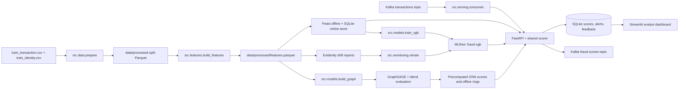

# Architecture and design

## Data flow

## Components

| Component | What it does and why it exists | Repository location |
|---|---|---|
| Data preparation | Joins the training transaction and identity tables, keeps the earliest contiguous time window, builds stable uid and chronological splits. | `src/data/prepare.py` |
| Causal feature builder | Computes prior-only per-uid velocity, amount, device and location history; encodes categories with a train-fit artifact. | `src/features/` |
| Feature store | Serves and retrieves feature history through Feast; uses a local file offline store and SQLite online store. | `src/feature_repo/` |
| XGBoost | Compares class weighting choices and a logistic baseline, uses validation PR-AUC, saves thresholds and metrics. | `src/models/train_xgb.py` |
| Heterogeneous graph/GNN | Links transaction nodes with uid, device, email domain and address; evaluates real versus shuffled links. | `src/models/build_graph.py`, `src/models/train_gnn.py` |
| Blend and ring analysis | Selects a blend on validation and groups flagged test transactions by shared non-hub entities. | `src/models/blend.py`, `scripts/ring_precision.py` |
| Model tracking | Stores experiments and candidate/champion versions; local file-store and HTTP modes are available. | MLflow calls in `src/models/`, `src/monitoring/`, `src/serving/` |
| Kafka producer/consumer | Replays the test split to Kafka, scores each transaction, persists output and publishes fraud scores. | `src/streaming/producer.py`, `src/serving/consumer.py` |
| API and persistence | Exposes score, alert, feedback, detail, ring and lightweight metrics endpoints; persists service state in SQLite. | `src/serving/` |
| Drift and retraining | Compares adjacent time windows with Evidently and can register an expanded-window candidate without automatic promotion. | `src/monitoring/` |
| Analyst dashboard | Displays alerts, case state, score explanations, rings and local drift/retraining summaries. | `src/dashboard/` |
| Packaging and deployment | Three purpose-specific Python images and a Compose-first demo; Minikube manifests are static-only and runtime unverified. | `docker/`, `k8s/`, `scripts/demo_*.sh`, root batch launchers |

## Key design decisions

- **Chronological train/validation/test split.** Fraud patterns and prevalence change over time; a shuffled split would mix future and past and make offline metrics less representative. The saved data summary records the split boundaries in `results/eda_summary.json`.
- **Causal per-uid features.** Each feature is computed only from strictly earlier events; tied timestamps are processed together so one tied transaction cannot reveal another. The implementation's window definitions are documented in `docs/phase_2_notes.md` and tested on synthetic boundaries.
- **Alert-budget threshold.** The serving cutoff is selected at the validation top-3% alert boundary to reflect analyst review capacity. The same score cutoff is applied to test, where it need not produce the same share of alerts.
- **Hub handling.** High-degree entity edges are capped based on training-degree distribution and hub uids remain represented as a feature. This limits graph domination while retaining transactions; the exact cap/removal counts are stored in `results/ablation.json`.
- **Candidate alias, manual promotion.** Retraining registers a candidate version and never silently replaces the serving champion. Promotion requires an explicit command so an operator can review evidence first.
- **Model and score limitations are explicit.** Validation selected a blend weight of 1.0, which leaves the final score equal to XGBoost. The same-snapshot GNN evaluation can use later-in-split feature messages, and ring assignments are offline; see `docs/phase_5_notes.md`.
