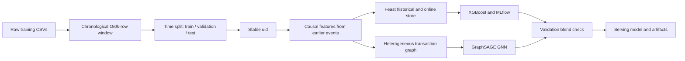
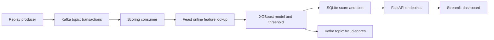
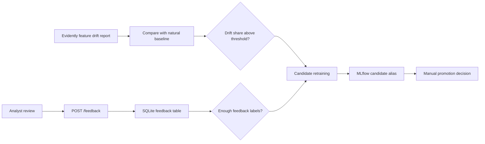

# Fraud Detection Project Guide

A beginner guide to explaining the prototype. The saved metrics below are from the repository's `results/` files. The Compose demo is the intended demonstration path, but live container behavior still needs to be verified on the Windows laptop. Kubernetes is static-only and is not the demo path.

## 1. The project in 60 seconds

A bank fraud desk receives many card transactions and has limited time to review them. This prototype gives each transaction a risk score, raises an alert for some transactions, and lets an analyst record a case outcome. It replays historical transactions in time order to demonstrate streaming. The model learns patterns from transaction and account history, then exposes scores through an API and dashboard. It is a learning prototype, not a bank's production decision system.

The data comes from the IEEE-CIS Kaggle competition. The project takes the first chronological window, uses time-ordered train, validation, and test splits, and reports results separately for each split. This matters because the fraud share changes over time.

## 2. How to start it

### A. One-click demo

Before starting, open Docker Desktop and wait for its engine to be running. The local WSL2 checkout also needs generated files: the processed feature parquet, Feast SQLite online store, exported XGBoost model, and GNN score/ring files. The launch script checks for these files. A fresh clone does not include them; prepare them with the manual steps below. The Kaggle training files must be downloaded by you under Kaggle's competition rules.

In Windows File Explorer, open the repository folder and double-click `START_DEMO.bat`. Keep the console window open. It checks Docker and ports, refreshes the dashboard image, starts Kafka, MLflow, API, consumer and dashboard, creates topics, and replays test transactions. The project notes estimate the first image build at about 15–25 minutes. On successful replay, expect a producer result with `published: 300`, followed by a message that the demo is ready and a browser at the dashboard. Runtime is not verified from this environment, so a successful run must be confirmed on your laptop.

If Docker Desktop is not running, the launcher tries to open it and waits. If it still fails, open Docker Desktop yourself, wait for the engine, and double-click `START_DEMO.bat` again. If services start but the score count remains zero, the producer may have published while the consumer failed; inspect the consumer's logs in Docker Desktop and share them for diagnosis.

Double-click `CHECK_DEMO.bat` to check containers, API health, saved scores, alerts, and dashboard reachability. Double-click `STOP_DEMO.bat` to stop the Compose services while retaining images and data volumes. A future start clears the demo's serving database so the replay begins cleanly. To reset Docker data completely, use Docker Desktop's volume controls and remove only this project's named volumes; this deletes saved demo and MLflow data. Do not remove volumes for unrelated projects.

### B. Manual setup and phase commands

Use WSL2 Ubuntu from the repository root. On a fresh clone, install Python through uv, create the virtual environment, and install pinned dependencies. Obtain the permitted IEEE-CIS training files and place the two training CSVs in `data/raw/`. Do not use Kaggle test files. The dataset is not included in Git.

Run these targets in order to rebuild local data and model artifacts:

```bash
uv python install 3.11
make setup
make data
make feature-store
make train-xgb-local
make export-model
make train-gnn-local
make drift
make retrain-local RETRAIN_ARGS="--dry-run"
```

`make data` prepares the chronological dataset. `make feature-store` rebuilds causal features, applies the Feast repository, materializes the SQLite store, and runs the feature parity check. XGBoost and GNN training use local MLflow files. The retraining command above is a dry run; it does not register a model. For the one-click demo, required artifacts must exist before starting.

Useful optional targets, if you want to explore individual pieces, are `make benchmark`, `make ring-precision`, `make test`, `make serve`, `make dashboard`, `make demo-start`, `make demo-check`, and `make demo-stop`. The demo batch files are the easier Windows controls. Do not use the Minikube targets for the normal demonstration; Kubernetes is unverified.

### C. Stop and reset

Use `STOP_DEMO.bat` for a normal stop. It retains images and named data. The next start clears the serving database. A full reset of generated training artifacts means rerunning the ordered data and training targets. A full Docker reset removes stored volumes and MLflow history; do that only if you intentionally want to discard them.

### D. The three URLs

- `http://localhost:8501` — Streamlit analyst dashboard: alerts, cases, ring summaries, and monitoring summaries.
- `http://localhost:8000/docs` — interactive FastAPI API documentation. `http://localhost:8000/health` is the simple health check.
- `http://localhost:5000` — MLflow experiment and model tracking interface.

The dashboard and API are intended for the demo; MLflow is there to inspect training runs and registered model versions. These URLs work only while the Compose services are running.

## 3. The tech stack

| Technology | Everyday analogy | What it does here | Why chosen | Where it lives | Without it |
|---|---|---|---|---|---|
| Python | A shared recipe language | Runs data preparation, features, models, API, monitoring and dashboard | One language connects the whole prototype | `src/`, `scripts/`, `notebooks/`, `Makefile` | Each stage would need a different runtime and integration glue |
| pandas and Parquet | Spreadsheet work plus compact filing cabinets | Joins/sorts tables and stores the processed feature table efficiently | Convenient for chronological tabular work | `src/data/prepare.py`, `src/features/build_features.py`, `data/processed/` | No consistent data preparation or shared local table format |
| XGBoost | A committee of small decision trees | Main fraud scoring model | Strong baseline for structured transaction data | `src/models/train_xgb.py`, `artifacts/xgb/` | No primary trained scoring model |
| PyTorch Geometric / GNN | A neighborhood map where linked accounts can pass notes | Tests whether entity relationships add useful fraud signal | Lets the project test graph structure explicitly | `src/models/build_graph.py`, `src/models/train_gnn.py`, `artifacts/gnn/` | No graph-based comparison; current blend would still use XGBoost alone |
| Feast | A labeled pantry that stores prepared ingredients for lookup | Stores offline history and serves online transaction features | Same feature definitions can be used for historical training and live lookup | `src/feature_repo/`, `src/features/feature_parity.py` | Scoring would need its own feature source and risk train/serve mismatch |
| MLflow | A lab notebook plus model shelf | Records experiments, metrics, artifacts, and model versions/aliases | Makes local and server tracking use the same training interface | `src/models/train_xgb.py`, `src/models/train_gnn.py`, `src/monitoring/retrain.py`, `mlruns_local/` | Harder to compare runs or track candidate models |
| Kafka | A post office with named mail trays | Holds transaction messages until the consumer reads and scores them | Decouples replaying transactions from scoring them | `src/streaming/producer.py`, `src/serving/consumer.py`, `docker/docker-compose.full.yml` | No message-buffered streaming demonstration |
| FastAPI | A reception desk with documented forms | Exposes scoring, health, alerts, feedback and metrics endpoints | Gives the dashboard and other clients a simple HTTP interface | `src/serving/api.py` | No standard API boundary for scoring and review |
| SQLite | A small local ledger | Persists demo scores, alerts and analyst feedback | Simple local persistence without a database server | `src/serving/repository.py`, runtime `serving.db` | Demo state would vanish when a process exits |
| Streamlit | A quick control panel built from Python | Shows alerts, case details, model contributions, and rings | Fast way to make an analyst-facing prototype | `src/dashboard/app.py`, `src/dashboard/data.py` | No visual analyst workflow |
| Evidently | A dashboard inspector comparing old and new batches | Compares feature and score distributions for drift | Produces repeatable drift reports and drift-share values | `src/monitoring/drift.py`, `results/drift/` | No implemented distribution-change report or drift trigger input |
| Docker and Compose | Labeled boxes and a small stage manager | Packages the API, dashboard and jobs; runs Kafka and MLflow beside them | Gives the intended one-click local demo a repeatable service setup | `docker/api.Dockerfile`, `docker/dashboard.Dockerfile`, `docker/jobs.Dockerfile`, `docker/docker-compose.full.yml`, `scripts/demo_start.sh`, `scripts/demo_check.sh`, `scripts/demo_stop.sh` | Users would install and start each service manually |
| Kubernetes / Minikube | A bigger stage manager for groups of boxes | Provides manifests for a local cluster deployment | Shows how the prototype could be organized as cluster workloads | `k8s/`, Makefile `k8s-*` targets | No cluster deployment templates; these are not needed for the demo |
| pytest | A practice exam for code behavior | Checks features, models, API, monitoring, dashboard and static deployment assumptions | Catches regressions without running the full service stack | `tests/` | No automated checks for expected behavior |
| Git and GitHub | A project history book and shared shelf | Tracks source, docs and results in commits; supports collaboration | Makes changes reviewable and recoverable | `.git/`, repository remote | No revision history or shared source workflow |

**Demo status:** Docker Compose is the intended demo route, but it has not passed an end-to-end verification here. The user run showed the producer published messages while the API stayed at zero scored transactions. The consumer logs are needed to identify that failure. Kubernetes/Minikube is not runtime verified.

## 4. The entire flow, as three stories

### Training flow



The data preparation uses a continuous time window, then splits rows in chronological order. A random split could put near-duplicate or future activity into training and make the model look better than it would on later transactions. A **feature** is an input value the model uses. Velocity, past amount average and change flags are computed using only strictly earlier transactions. This reduces **leakage**: accidentally letting future information influence a past prediction. Labels are never GNN node inputs.

The alert cutoff is chosen on validation to fit a review budget: the saved threshold flags the top 3% of validation transactions, with a transaction-ID tie rule. This reflects a fraud desk's limited capacity. The graph model was evaluated, but the validation blend selected XGBoost weight 1.0. Therefore the live final score is XGBoost alone; the GNN remains an experiment. The GNN's offline snapshot can still pass features from later transactions in the same split, so its scores are somewhat optimistic compared with truly incremental scoring.

### Live scoring flow



A **topic** is a named stream of messages. A **producer** writes transactions to it. A **consumer** reads them and runs the scorer. Kafka is used here to demonstrate that sending transactions and scoring them are separate jobs: messages can wait while a consumer is catching up. Feast returns prepared features for the transaction ID; the model returns a score; SQLite stores the result; the dashboard reads the API. Kafka is part of the intended Compose path, while the dashboard's seed script can create example records if replay fails. The current user run published the replay but scored zero rows, so the live consumer path needs diagnosis.

### Monitoring and feedback flow



Evidently compares feature distributions between a reference window and a new window. The natural baseline is made from consecutive real windows, so ordinary time movement is not automatically treated as an incident. The configured threshold is read from `results/drift/natural_baseline.json`: the recorded rule is the natural maximum plus a margin, yielding 0.60. The synthetic shifted window is a stress test, not evidence of a real attack. Retraining registers an MLflow `candidate`; it does not replace the serving `champion`. Promotion is a separate manual choice. Feedback labels arrive after an analyst review and are unavailable when the original transaction is scored.

## 5. One transaction's journey

This walkthrough is computed from the local test feature parquet and the exported XGBoost model. It is an offline example, not a record confirmed from the Docker run.

The chronological test row with transaction ID **3107315** has amount **300.0**. Its saved causal features show **0** transactions in the prior one-hour window, **2** in the prior twenty-four-hour window, and amount divided by past mean of about **1.2206**. Its device-change flag is **1.0**, location-change flag is **0.0**, and prior-transaction count for its uid is **63**. The test label in the offline dataset is fraud (`isFraud = 1`). These values are from `data/processed/features.parquet`.

The XGBoost model's actual score on that row is **1.0**. The saved serving cutoff is about **0.1193**, from `artifacts/xgb/threshold.json`. Its score exceeds the cutoff, so it is an alert under the saved XGBoost decision rule. In a live demo the dashboard would show its alert and score if the message reaches the consumer and the stored score is fetched. The current failed user run did not score messages, so this specific row has not been observed live in the dashboard. Paths: `artifacts/xgb/model/`, `artifacts/xgb/feature_list.json`, `artifacts/xgb/threshold.json`.

## 6. The numbers I can quote

All values below are read from the named JSON result. PR-AUC is sensitive to the fraud share. Validation prevalence is **1.72%** and test prevalence is **3.67%**; compare each PR-AUC with its own split's random baseline.

| Measure | Saved result | Plain-English meaning | Source |
|---|---:|---|---|
| Train / validation / test rows | 90,000 / 30,000 / 30,000 | Chronological split sizes | `results/eda_summary.json` |
| Fraud prevalence overall / train / validation / test | 2.6467% / 2.6156% / 1.72% / 3.6667% | Fraud is rare and differs across time | `results/eda_summary.json` |
| Unique uids; median / max transactions per uid | 24,084; 2 / 2,626 | Most identities repeat, with a long tail | `results/eda_summary.json` |
| Random PR-AUC, validation / test | 0.01720 / 0.03667 | Random ranking is about the positive share | `results/xgb_metrics.json` |
| Logistic regression PR-AUC, validation / test | 0.08321 / 0.15682 | Simple linear baseline | `results/xgb_metrics.json` |
| XGBoost unweighted PR-AUC, validation / test | 0.41722 / 0.55306 | Best saved XGBoost run; weight is not applied to positives | `results/xgb_metrics.json` |
| XGBoost weighted PR-AUC, validation / test | 0.34607 / 0.50755 | Positive class weight did not improve these saved scores | `results/xgb_metrics.json` |
| XGBoost lift over random PR-AUC, validation / test | 24.26x / 15.08x | Model PR-AUC divided by each split's base rate | Computed from `results/xgb_metrics.json` |
| GNN real-edge PR-AUC, validation / test | 0.15886 / 0.27174 | GraphSAGE performance on the real graph | `results/ablation.json` |
| GNN shuffled-edge PR-AUC, validation / test | 0.14072 / 0.26350 | Randomly altered relationships perform similarly | `results/ablation.json` |
| Blend PR-AUC and XGBoost blend weight, validation / test | 0.41722 / 0.55306; 1.0 | Validation selected XGBoost alone | `results/ablation.json` |
| XGBoost precision / recall at 1%, 3% alert budgets | Validation 60.33% / 35.08%, 29.33% / 51.16%; test 89.67% / 24.45%, 61.33% / 50.18% | Top-ranked transactions at review-capacity settings | `results/xgb_metrics.json` |
| Serving threshold and validation alert rate | 0.11929; 3% | Cutoff chosen for validation review budget | `results/xgb_metrics.json` |
| Scorer p50 / p95 / p99 latency; throughput | 26.28 / 52.14 / 74.36 ms; 33.01 transactions/s | Feast lookup plus inference, excluding Kafka | `results/latency.json` |
| Feast feature parity | 67/67 fields equal on a sample of 100 | Historical and online results matched for this sample | `results/feature_parity.json` |
| Natural drift baseline mean / p95 / max; trigger | 0.2158 / 0.4231 / 0.50; 0.60 | Threshold sits above the observed natural maximum by the saved margin | `results/drift/natural_baseline.json` |
| Shifted / recent real window drift share | 1.0 / 0.0769 | Synthetic stress shift fires; recent real window does not | `results/drift/shifted_window_drift.json`, `results/drift/recent_window_drift.json` |
| Candidate / champion test PR-AUC | 0.59838 / 0.55306 | Final comparison used test only for this comparison; promotion remains manual | `results/retrain_log.json` |
| Fraud rate inside multi-transaction rings / outside | 49.05% / 59.11% | These rings did not beat the outside-ring fraud rate | `results/ring_precision.json` |
| Strong-only / weak-link-containing ring rate; largest ring share | 62.14% / 46.61%; 61.40% | Weak links create an oversized component; ring findings are offline and label-based | `results/ring_precision.json` |

**Caution:** Test prevalence is higher than validation prevalence. This helps explain why precision at a fixed alert budget can be higher on test. It does not mean the model improved between those splits.

The Feast parity check compares historical and online feature values for sampled transactions. It is evidence of consistency for that sample, not proof that every feature is correct or that the live Kafka service works.

## 7. Glossary

- **Alert budget:** The share of transactions a team can review, such as the highest-scoring fraction.
- **Artifact:** A saved model, threshold, feature list, or report used after a run.
- **Base rate / prevalence:** The share of rows that are fraud in a particular dataset split.
- **Candidate / champion:** Candidate is a proposed model version; champion is the currently designated serving version.
- **Causal feature:** A value computed only from information available before the transaction being scored.
- **Class imbalance:** One outcome is much rarer than another; fraud is the rare class here.
- **Consumer:** A program that reads messages from a Kafka topic.
- **Container:** A running packaged program with its own filesystem and dependencies.
- **Data leakage:** Future or label information accidentally entering model inputs or evaluation.
- **Drift:** A change in data or score patterns between time periods.
- **Embedding:** A learned numeric representation of an item or entity used by a model.
- **Feature:** One input value, such as amount or prior transaction count.
- **Feature store:** A system that saves and serves prepared model inputs consistently.
- **Feast:** The feature store library used by this project.
- **GNN:** A graph neural network that learns from connected entities as well as node features.
- **Graph:** Objects represented as nodes and their relationships represented as edges.
- **Health check:** A small test that reports whether a service is ready.
- **Image:** The packaged template from which a container starts.
- **Leakage:** Short name for data leakage.
- **MLflow:** A tool for recording model experiments and managing model versions.
- **Parquet:** A compressed column-based file format for tables.
- **PR-AUC:** Area under the precision-recall curve; useful when the positive class is rare.
- **Producer:** A program that writes messages to a Kafka topic.
- **ROC-AUC:** A ranking measure comparing true-positive and false-positive rates across cutoffs.
- **Ring:** A connected group of transactions sharing selected account or device entities.
- **SQLite:** A database stored in a file, suitable for this local demonstration.
- **Threshold:** The score cutoff used to decide whether to raise an alert.
- **Topic:** A named stream of messages in Kafka.
- **Train/validation/test split:** Data portions used to fit, choose settings, and evaluate later behavior.
- **XGBoost:** A library that builds ensembles of decision trees for structured data.

## 8. What I can honestly claim and what I must not claim

**I can claim:** the repository contains a chronological data pipeline, causal history features, Feast historical/online parity checks, XGBoost experiments, a GNN comparison, Kafka producer/consumer code, a FastAPI service, a dashboard, drift reports, and candidate registration logic. The checked offline results show that XGBoost is the selected scoring model. The tests cover important logic and static deployment assumptions.

**I must not claim:**

- That the GNN improves the final model. The selected blend weight is XGBoost alone, and the shuffled-edge control is close to the real graph.
- That rings reliably identify fraud groups. Rings with weak links can join many unrelated rows; the largest ring accounts for a large share of flagged rows.
- That a real production incident triggered retraining. The demo trigger is shown with a synthetic stress test.
- That the drift score uses labels at live scoring. Analyst labels arrive after review.
- That Compose is verified end to end. A user run published transactions but reported zero scores; consumer logs are needed to find the cause.
- That Kubernetes runs. Its manifests were statically checked, not deployed.
- That this is production-ready or makes autonomous financial decisions. Storage is local SQLite and the evaluation is on one competition dataset.

## 9. Interview questions and answers

### Why use a time split instead of a random split?

The service must score future transactions using past examples. A time split simulates that order. A random split can mix earlier and later events, making evaluation too optimistic.

### What is data leakage, and how did you reduce it?

Leakage is information from the future or the answer leaking into model inputs. The feature builder processes transactions chronologically and uses strictly earlier history for velocity, past amount mean, and change flags. The label and identifier columns are excluded from model inputs.

### Why use PR-AUC instead of accuracy?

Fraud is a small fraction of transactions. A model that calls every row legitimate can have high accuracy while finding no fraud. PR-AUC focuses on precision and recall for the rare positive class.

### Why did unweighted XGBoost beat the weighted version?

The saved validation and test PR-AUC values are higher for the unweighted run. Class weighting can change the ranking and calibration; it is not guaranteed to help. The result is specific to this split and setup.

### What did the shuffled-edge control show?

The shuffled-edge GNN scored close to the real-edge GNN. That suggests this graph did not demonstrate strong useful relationship signal. It is why the GNN is not used to lift the final score.

### Why is test precision at a 1% alert budget higher than validation?

The test fraud prevalence is higher than validation. At the top 1% score budget, the saved precision is higher on test too. Different prevalence affects precision, so the values are not a direct like-for-like comparison.

### What is Feast for?

Feast stores and serves model features. Training can fetch historical features; serving can fetch online features. The parity test compares values for a sample, but cannot prove every possible transaction or production deployment is correct.

### Why Kafka?

Kafka separates the program sending transactions from the program scoring them. Its topic buffers messages so the consumer can read as it is ready. It also models a common streaming service pattern.

### What happens if the consumer is down?

Kafka retains messages according to its configured storage and retention. When a consumer returns with the same group, it can continue from its saved offset. This prototype should be checked in its actual Compose environment; the latest run published transactions but recorded no scores.

### How would you scale this?

First measure throughput and identify bottlenecks. Then run multiple consumer instances in a Kafka consumer group, partition topics, use durable shared storage, and scale API replicas. Preserve transaction ordering where causal state depends on it.

### How would you detect concept drift when labels arrive late?

Monitor input and score distributions first, then compare predictions with labels once analysts confirm cases. Feature drift alone is a warning, not proof that fraud behavior or model quality changed.

### Why use a validation alert budget?

A fraud desk has limited review capacity. Selecting the cutoff on validation for a fixed share maps scores to that capacity. It avoids selecting an operating point by maximizing an evaluation metric like F1.

### Why is the final score XGBoost alone?

The validation search selected XGBoost weight 1.0 in the blend. That leaves no contribution from the GNN. The simpler model won under the stated validation criterion.

### What does the feature parity result prove?

For the sampled transactions, historical and online Feast values matched across the saved feature fields. It does not prove correctness outside that sample, model quality, or Kafka consumer health.

### Why does the graph model have a temporal caveat?

Within an offline snapshot, a transaction can receive feature messages from linked transactions later in the same split. Labels are not passed as node inputs, but the extra future features can make offline scores optimistic relative to live incremental scoring.

### Why is the drift threshold set to 0.60?

The saved natural baseline has maximum drift share 0.50. The project rule adds the saved 0.10 margin, producing 0.60. A deliberately shifted synthetic slice is used to show the trigger can fire.

### What does the synthetic stress test show?

It shows that the configured comparison detects a deliberately strong change in selected inputs. It does not show that natural traffic has drifted or that a real fraud attack occurred.

### Why are fraud labels unavailable at live scoring?

A label requires investigation or a later outcome such as a confirmed case. At score time the system only has transaction features, so the label cannot be an input without leakage.

### What do the rings mean, and what are their limits?

A ring groups flagged transactions connected by shared entities such as uid or device. Email and address links can be weak; in these results, weak links lead to a giant component and the ring fraud rate is below the outside-ring rate.

### What would you do next?

Inspect consumer logs and fix the Compose scoring path, then rerun the one-time demo verification. After that, improve ring definitions, validate on newer independent data, and replace local SQLite with durable storage before claiming operational readiness.

## 10. A two-minute spoken explanation and cheat sheet

### Spoken explanation

“Banks receive far more transactions than an analyst can investigate one by one. This project is a prototype that ranks transactions by fraud risk and gives analysts a small dashboard for reviewing alerts.

We begin with historical IEEE-CIS training transactions. We sort them in time order, create train, validation and test periods, and build features from prior activity only. For example, the model can see how many earlier transactions an identity made recently, but it cannot use the current transaction to calculate its own history. This helps prevent data leakage.

We train XGBoost as the main model and compare it with a logistic regression baseline and a graph neural network. The graph links transactions to shared identities and devices. In the saved validation comparison, the blend selected XGBoost alone, and the shuffled-edge result was close to the real graph result. So I present the GNN as an experiment, not a proven improvement.

For the streaming demonstration, a producer sends test transactions to Kafka. A consumer reads each message, asks Feast for online features, scores it, and saves the result to SQLite. FastAPI exposes the saved records and Streamlit displays alerts and case details. The user run published transactions but recorded zero scores, so the consumer path still needs diagnosis before I claim the full live demo works.

Evidently compares data windows with a natural baseline. The drift threshold is set from that baseline, and a synthetic shifted window demonstrates the trigger. A retrained model becomes a candidate; a person must decide whether to promote it. The prototype illustrates the pieces and their limits. It is not a production fraud system, and Kubernetes is not runtime verified.”

### Cheat sheet: the flow in ten points

1. Kaggle training CSVs are the raw input.
2. Rows are sorted by time and split chronologically.
3. A stable uid connects transactions from the same card-derived identity.
4. Causal features summarize only earlier activity.
5. Feast stores historical and online versions of prepared features.
6. XGBoost is the selected final model; the GNN is an experiment.
7. The alert cutoff comes from a validation review budget.
8. Kafka carries transaction messages from producer to consumer.
9. The consumer scores, SQLite stores, FastAPI serves, and Streamlit displays.
10. Evidently reports drift; a candidate model waits for manual promotion.
