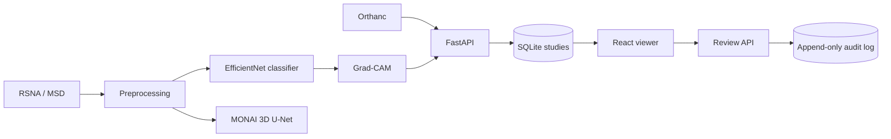

# AI-Assisted Medical Imaging and Diagnosis System (AIML-02)

**For education only, not clinical use.**

A cross-platform educational project showing chest X-ray preprocessing and classification, hippocampus segmentation, Grad-CAM overlays, and a reviewable local API and React viewer. It is not a medical device and must not be used for diagnosis or care decisions.

## Features

- Patient-level RSNA Pneumonia subset: DICOM inversion/windowing, 224x224 uint8 preprocessing, balanced class sampling, and 70/15/15 train/validation/test splits.
- EfficientNet-B0 classifier with ImageNet weights when available and random-init fallback; weighted/balanced sampling, train-only augmentations, metrics, and plots.
- MONAI 3D U-Net workflow for MSD Hippocampus, with clearly marked synthetic demo mode.
- Grad-CAM overlays for test images.
- FastAPI local upload and optional Orthanc polling; SQLite study records and append-only review audit log.
- React viewer with newest-first study list, model/demo banner, pneumonia probability and predicted-class confidence, Grad-CAM opacity control, reviewer/comment fields, and audit log.
- DVC tracked processed dataset with a local remote.

## Architecture



See [detailed architecture and API](AIML-02/docs/architecture.md).

## Setup

Use Python 3.12 in the repository `.venv`. No data are downloaded. The local RSNA data are under `AIML-02/data/raw/rsna/`; set `RSNA_DIR` if your path differs. Set `MSD_DIR` to the MSD `Task04_Hippocampus` folder for real segmentation training.

Windows PowerShell:

```powershell
py -3.12 -m venv .venv
.\.venv\Scripts\python.exe -m pip install -r requirements.txt
.\.venv\Scripts\python.exe run.py data
```

The RSNA raw files are not included in Git. Before `run.py data`, provision `AIML-02/data/raw/rsna/` or set `RSNA_DIR` to the local dataset. The trained `classifier.pt` and matching `metrics.json` are also not committed; copy them to `AIML-02/models/` on a clean checkout.

Linux/Colab: activate the root `.venv` (or use `.venv/bin/python`) and run `python run.py <task>` from the repository root.

## Run tasks

- Setup dependencies: `python run.py setup`
- Build the RSNA processed dataset: `python run.py data`
- Build a synthetic dataset if RSNA is absent: `python run.py data -- --demo`
- Train classification: `python run.py train-cls -- --epochs 3`
- Quick CPU classification smoke run: `python run.py train-cls -- --epochs 1 --max-samples 32`
- Generate Grad-CAM overlays: `python run.py gradcam`
- Train segmentation using MSD: `python run.py train-seg -- --epochs 2`
- Run synthetic segmentation demo if MSD is absent: `python run.py train-seg -- --demo --epochs 1`
- Reset local study database, uploads, and heatmaps: `python run.py reset-db`
- Start local API at port 8000: `python run.py serve`
- Check the classifier on one bundled DICOM sample: `python run.py check-model`
- Load all bundled DICOM samples into the running local service: `python run.py load-samples`
- Run tests: `python run.py test`
- Start the React viewer in a second terminal: `cd AIML-02/viewer; npm install; npm run dev`
- Validate Docker services: `docker compose -f AIML-02/docker/docker-compose.yml up --build`

The classifier loader defaults to `AIML-02/models/classifier.pt`. A trained checkpoint is currently present in the local workspace; model files are ignored by Git, so copy `classifier.pt` and its adjacent `metrics.json` into `AIML-02/models/` on any other checkout. To train again in Colab/Kaggle, upload `AIML-02/data/processed/dataset.npz`, run `python run.py train-cls -- --epochs 3`, then download both files from the training output directory. Check the installed model with `python run.py check-model`. Without a checkpoint, the UI shows a DEMO warning. To load the bundled DICOM scans, start the API with `python run.py serve`, open another terminal at the repository root, and run `python run.py load-samples`.

## Results

| Work item | Result |
|---|---|
| RSNA data build | Complete: 3,000 images; 2,100 train, 450 validation, 450 test; each split class balanced. Compressed NPZ: 110,357,019 bytes. See [dataset counts](AIML-02/docs/DATASET_STATS.md). |
| Current classifier | Stored metrics: 450 held-out test images; accuracy 0.7978, AUC 0.8843, precision 0.8018, recall 0.7911, F1 0.7964; confusion matrix `[[181, 44], [47, 178]]`; `demo:false`, ImageNet weights. The metrics file reports `device: cpu`; Colab GPU provenance should be reconciled before claiming GPU training. |
| Historical classification smoke | Earlier data variant: 1 epoch, 32 rows, 5-row test subset; accuracy 0.40, AUC 0.50, precision 0.40, recall 1.00, F1 0.57; random initialization. Retained as historical evidence only. |
| Grad-CAM | API reports aligned heatmaps targeting the predicted class for the 10 current studies; alignment and argmax-target regression tests pass. |
| Segmentation demo | MSD Task04_Hippocampus is absent. One-epoch synthetic training produced illustrative training-batch Dice 0.0367; this is not real-image or held-out performance. |
| Automated tests | 6 passed, 7 upstream deprecation warnings in 10.85s. See [test output summary](AIML-02/docs/TEST_RESULTS.md). |
| Viewer production build | Verified with Vite 8.3.8; `npm install`, `npm run build`, and dev server HTTP checks passed. |
| Docker runtime | Compose config validated; **PENDING - run `docker compose -f AIML-02/docker/docker-compose.yml up --build`** when Docker daemon is available. |

## Screenshots

Placeholder: capture the study list, selected scan with heatmap overlay, review controls, and audit log after running the viewer.

## Limitations

The balanced subset does not represent real-world disease prevalence. Dataset population and scanner coverage may not generalize; labels are noisy proxies, and bounding boxes are not localization ground truth. Image artifacts and acquisition differences can influence output. The current classifier metrics are from one held-out split of this balanced RSNA subset and are not external validation. The older five-case smoke metrics do not describe the current model. Segmentation remains demo-only because MSD Task04_Hippocampus is absent: its synthetic volumes and hard-coded labels are only a pipeline check, and the reported Dice is from a training batch, not a validation set. Without a checkpoint, the service runs in DEMO mode with neutral placeholder values and displays a warning; those values are not predictions. No output supports clinical use.

## Project documents

- [Model card](AIML-02/docs/MODEL_CARD.md)
- [Implementation decisions](AIML-02/docs/DECISIONS.md)
- [10-minute presentation outline](AIML-02/docs/PRESENTATION.md)
- [Reflection prompts](AIML-02/docs/REFLECTION_TEMPLATE.md)
- [Test and run results](AIML-02/docs/TEST_RESULTS.md)
