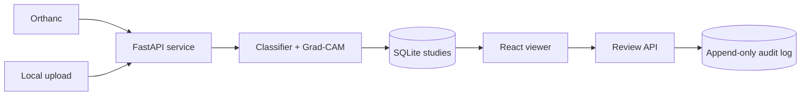

# Architecture and API

**For education only, not clinical use.**

POST `/upload` accepts multipart field `file` containing a PNG/JPEG. GET `/health`, `/studies`, `/studies/{id}`, `/studies/{id}/image`, `/studies/{id}/heatmap`, `/audit-log`; POST `/studies/{id}/review` takes `{decision: approve|reject, reviewer, comment}`. CORS is enabled.

The service polls Orthanc instances when `ORTHANC_URL` is set and remains usable via local upload without Orthanc. Docker runtime: **PENDING - run `docker compose -f AIML-02/docker/docker-compose.yml up --build`**.
