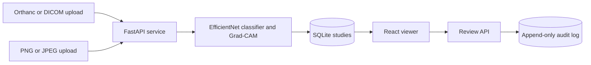

# Architecture and API

**For education only, not clinical use.**

The service loads the CPU-compatible EfficientNet-B0 checkpoint from `MODEL_PATH` (default `AIML-02/models/classifier.pt`). It reads weights with `map_location="cpu"` and uses an adjacent `metrics.json` for the displayed model version when available. `/health` returns `model_loaded`, `model_version`, `mode` (`real` or `demo`), and `education_only`. Demo probabilities are placeholders and must not be interpreted as model output.

API endpoints:

- `POST /upload`: multipart field `file`; accepts PNG, JPEG, or DICOM. The original filename is preserved for raster uploads; DICOM studies are named from PatientID when present.
- `GET /health`: model state and version.
- `GET /studies`: newest studies first. Each result includes predicted label, predicted-class `confidence` (0.5 to 1.0), `pneumonia_probability` (0 to 1), status, and model version.
- `GET /studies/{id}`: one study record.
- `GET /studies/{id}/image` and `GET /studies/{id}/heatmap`: original scan and Grad-CAM heatmap image.
- `POST /studies/{id}/review`: JSON `{ "decision": "approve" | "reject", "reviewer": "name", "comment": "..." }`. A study can be reviewed once. The audit row stores model version, confidence and pneumonia probability as shown at review time.
- `GET /audit-log`: append-only review records, newest first.

Tests override `DATABASE_URL`, `DATA_DIR`, and `MODEL_PATH` to use temporary storage. Reset the development database and uploaded images with `python run.py reset-db`. Run the service without Docker with `python run.py serve`; local API upload remains available when Orthanc is absent.
