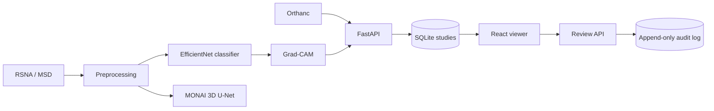

# AI-Assisted Medical Imaging and Diagnosis System (AIML-02)

**For education only, not clinical use.**

A cross-platform educational project showing chest X-ray preprocessing and classification, hippocampus segmentation, Grad-CAM overlays, and a reviewable local API and React viewer. It is not a medical device and must not be used for diagnosis or care decisions.

## Features

- Patient-level RSNA Pneumonia subset: DICOM inversion/windowing, 224x224 uint8 preprocessing, balanced class sampling, and 70/15/15 train/validation/test splits.
- EfficientNet-B0 classifier with ImageNet weights when available and random-init fallback; weighted/balanced sampling, train-only augmentations, metrics, and plots.
- MONAI 3D U-Net workflow for MSD Hippocampus, with clearly marked synthetic demo mode.
- Grad-CAM overlays for test images.
- FastAPI local upload and optional Orthanc polling; SQLite study records and append-only review audit log.
- React viewer with study list/detail, confidence bar, heatmap opacity control, review actions, and audit log.
- DVC tracked processed dataset with a local remote.

## Architecture



See [detailed architecture and API](AIML-02/docs/architecture.md).

## Setup

Use Python 3.12 in the repository `.venv`. No data are downloaded. The local RSNA data are under `AIML-02/data/raw/rsna/`; set `RSNA_DIR` if your path differs. Set `MSD_DIR` to the MSD `Task04_Hippocampus` folder for real segmentation training.

Windows PowerShell:

```powershell
.\.venv\Scripts\python.exe -m pip install -r requirements.txt
.\.venv\Scripts\python.exe run.py data
```

Linux/Colab: activate the root `.venv` (or use `.venv/bin/python`) and run `python run.py <task>` from the repository root.

## Run tasks

- Setup dependencies: `python run.py setup`
- Build the RSNA processed dataset: `python run.py data`
- Build a synthetic dataset if RSNA is absent: `python run.py data -- --demo`
- Train classification: `python run.py train-cls -- --epochs 3`
- Quick CPU classification smoke run: `python run.py train-cls -- --epochs 1 --max-samples 32`
- Generate Grad-CAM overlays: `python run.py gradcam`
- Train segmentation using MSD: `python run.py train-seg -- --epochs 2`
- Run synthetic segmentation demo if MSD is absent: `python run.py train-seg -- --demo --epochs 1`
- Start local API at port 8000: `python run.py serve`
- Run tests: `python run.py test`
- Start the React viewer in a second terminal: `cd AIML-02/viewer; npm install; npm run dev`
- Validate Docker services: `docker compose -f AIML-02/docker/docker-compose.yml up --build`

To use Orthanc samples, start Docker services, then run `python -m src.service.push_samples` with `PYTHONPATH` including `AIML-02` (or from the project folder with the module path configured).

## Results

| Work item | Result |
|---|---|
| RSNA data build | Complete: 3,000 images; 2,100 train, 450 validation, 450 test; each split class balanced. Compressed NPZ: 110,357,019 bytes. See [dataset counts](AIML-02/docs/DATASET_STATS.md). |
| Historical classification smoke | Earlier data variant: 1 epoch, 32 rows, 5-row test subset; accuracy 0.40, AUC 0.50, precision 0.40, recall 1.00, F1 0.57; random initialization. It does not describe the current dataset. Full run: **PENDING - run `python run.py train-cls -- --epochs 3`**. |
| Grad-CAM | 10 overlays generated locally from the earlier smoke checkpoint. |
| Segmentation demo | Synthetic one-epoch training; illustrative first-batch Dice 0.0367 on synthetic data, not held-out performance. |
| Automated tests | 4 passed, 17 upstream deprecation warnings in 15.90s. See [test output summary](AIML-02/docs/TEST_RESULTS.md). |
| Viewer production build | Verified with Vite 8.3.8; `npm install`, `npm run build`, and dev server HTTP checks passed. |
| Docker runtime | Compose config validated; **PENDING - run `docker compose -f AIML-02/docker/docker-compose.yml up --build`** when Docker daemon is available. |

## Screenshots

Placeholder: capture the study list, selected scan with heatmap overlay, review controls, and audit log after running the viewer.

## Limitations

The balanced subset does not represent real-world disease prevalence. Dataset population and scanner coverage may not generalize; labels are noisy proxies, and bounding boxes are not localization ground truth. Image artifacts and acquisition differences can influence output. The historical smoke classification metrics use five test images from the earlier sample variant and do not describe the rebuilt dataset; the segmentation Dice is from synthetic training data. The local fallback is a simple image statistic if no checkpoint exists. No output supports clinical use.

## Project documents

- [Model card](AIML-02/docs/MODEL_CARD.md)
- [Implementation decisions](AIML-02/docs/DECISIONS.md)
- [10-minute presentation outline](AIML-02/docs/PRESENTATION.md)
- [Reflection prompts](AIML-02/docs/REFLECTION_TEMPLATE.md)
- [Test and run results](AIML-02/docs/TEST_RESULTS.md)
