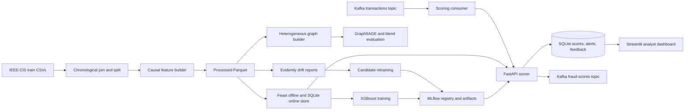

# Real-Time Financial Fraud Detection Platform

This project is a reproducible prototype for identifying potentially fraudulent payment transactions under severe class imbalance. It prepares a chronological IEEE-CIS training window, creates causal per-identity features, compares XGBoost and GraphSAGE models, and exposes scoring, analyst feedback, monitoring, and replay components. The repository includes local results and offline tests; the Kafka, container, and Kubernetes paths still require runtime verification on the user's WSL2 machine.

## Architecture



## Results

Metrics below are extracted from the tracked `results/*.json` files. PR-AUC must be read alongside each split's fraud base rate: prevalence differs substantially (**1.72% validation versus 3.67% test**), so the absolute PR-AUC values are not directly comparable without context.

| Measurement | Validation | Test / result | Source |
|---|---:|---:|---|
| Logistic regression PR-AUC | 0.08321 | 0.15682 | `results/xgb_metrics.json` |
| Random-ranking PR-AUC (= split fraud rate) | 0.01720 | 0.03667 | `results/xgb_metrics.json` |
| XGBoost unweighted PR-AUC | 0.41722 | 0.55306 | `results/xgb_metrics.json` |
| XGBoost weighted PR-AUC | 0.34607 | 0.50755 | `results/xgb_metrics.json` |
| GNN real graph PR-AUC | 0.15886 | 0.27174 | `results/ablation.json` |
| GNN shuffled-edge PR-AUC | 0.14072 | 0.26350 | `results/ablation.json` |
| Blend PR-AUC (XGBoost weight 1.0) | 0.41722 | 0.55306 | `results/ablation.json` |
| Scorer latency; Feast lookup + model, not Kafka | — | p50 26.28 ms; p95 52.14 ms; p99 74.36 ms; 33.01 tx/s | `results/latency.json` |
| Feast historical/online parity | — | 67/67 fields equal on 100 sampled transactions | `results/feature_parity.json` |
| Natural-window drift trigger | — | threshold 0.60; natural max 0.50 | `results/drift/natural_baseline.json` |
| Candidate versus champion PR-AUC | — | candidate 0.59838; champion 0.55306 | `results/retrain_log.json` |
| Flagged test ring precision | — | strong-link-only 0.62143; weak-link-containing 0.46614; outside rings 0.59107 | `results/ring_precision.json` |

These are saved experiment outputs, not claims of a deployed production service. The serving threshold comes from the validation top-3% boundary; because scores shift, its test alert share is not guaranteed to remain 3%.

## Quick start

Run from WSL2 Ubuntu with the repository in the Linux filesystem, such as `~/fraud-platform`. Install the pinned environment:

```bash
uv python install 3.11
make setup
.venv/bin/python --version
```

Download `train_transaction.csv` and `train_identity.csv` from the [IEEE-CIS Fraud Detection Kaggle competition data page](https://www.kaggle.com/competitions/ieee-fraud-detection/data) after accepting the competition's rules. Place only those training files in `data/raw/`; do not use the competition test files. Raw files are not tracked.

Build artifacts in order:

```bash
make data
make features
make feature-store
make train-xgb-local
make export-model
make train-gnn-local
make drift
make retrain-local RETRAIN_ARGS="--dry-run"
```

Feast materialization and model training use the generated data; training outputs under `results/`, `artifacts/`, the local MLflow store, and Feast's SQLite files are required for later serving/deployment. They are not all present in a fresh clone.

## Run the demo

### Docker Compose fallback

First complete the data and artifact build above, then build the three runtime images and start the stack:

```bash
docker build -f docker/api.Dockerfile -t fraud-api:phase8 .
docker build -f docker/dashboard.Dockerfile -t fraud-dashboard:phase8 .
docker build -f docker/jobs.Dockerfile -t fraud-jobs:phase8 .
docker compose -f docker/docker-compose.full.yml up -d
docker compose -f docker/docker-compose.full.yml ps
docker compose -f docker/docker-compose.full.yml run --rm api python -m src.streaming.producer --docker --limit 1000 --rate 20
curl http://localhost:8000/health
curl http://localhost:8000/metrics-lite
```

Expected producer output includes `"published": 1000`; consumer persistence is asynchronous, so check `/metrics-lite` again until the score count settles. Runtime is **UNVERIFIED** in this environment.

### Minikube

```bash
minikube start --driver=docker --memory=5120 --cpus=3
make k8s-build
make k8s-up
kubectl wait --for=condition=Ready pod -l app=kafka -n fraud --timeout=5m
kubectl wait --for=condition=Available deployment/scoring -n fraud --timeout=10m
kubectl wait --for=condition=Available deployment/dashboard -n fraud --timeout=10m
make k8s-demo
make k8s-status
```

In separate terminals run `kubectl port-forward -n fraud svc/scoring 8000:8000`, `kubectl port-forward -n fraud svc/dashboard 8501:8501`, and `kubectl port-forward -n fraud svc/mlflow 5000:5000`. Open the dashboard at `http://localhost:8501`. Minikube runtime is **UNVERIFIED**; the manifests and static tests do not prove that pods start.

## Tests

```bash
.venv/bin/python -m pytest -q
```

The latest full-suite run recorded **50 passed, 40 warnings**. The warning count includes upstream deprecation and synthetic drift-test numerical warnings; a passing test suite does not verify Kafka, MLflow HTTP, Docker, or Kubernetes runtime behavior.

## Project structure

- `src/data/`, `src/features/`, `src/feature_repo/`: chronological preparation, causal features, and Feast.
- `src/models/`: XGBoost, graph creation, GNN, and blending.
- `src/streaming/`, `src/serving/`: Kafka replay/consumer, scoring API, and SQLite persistence.
- `src/monitoring/`: Evidently reports and candidate retraining.
- `src/dashboard/`: Streamlit analyst interface.
- `docker/`, `k8s/`: split container images, Compose, and Kubernetes resources.
- `tests/`, `notebooks/`, `results/`, `docs/`: tests, EDA, saved results, and documentation.

## Known limitations

- The GNN does not improve the final XGBoost score: validation selection chose an XGBoost blend weight of 1.0. The shuffled-edge control is close to the real graph, so graph-structure value is not established (`results/ablation.json`).
- Weak entity links can join unrelated transactions into a giant ring; the largest component contains 727 flagged test rows, 61.4% of flagged rows (`results/ring_precision.json`). Ring assignment is offline and uses ground-truth labels only for post-hoc analysis.
- Validation/test GNN scoring uses cumulative snapshots. A transaction can receive feature messages from later transactions in the same split, so offline GNN results are optimistic relative to incremental live scoring.
- The retraining example was triggered by a deliberately synthetic stress window (drift share 1.0); the observed recent real window has drift share 0.0769 against a 0.60 trigger (`results/drift/shifted_window_drift.json`, `recent_window_drift.json`). This demonstrates mechanics, not a real-world retraining event.
- C*/D* columns are vendor-provided transaction aggregates, not newly derived variables; their semantics are not independently documented here.
- SQLite serving storage and Kubernetes `emptyDir` volumes are demonstration storage, not durable or production-grade persistence.
- Kubernetes manifests, image-size estimates and resource limits are statically checked. Docker/Compose/Minikube runtime remains **UNVERIFIED** until run on the user's machine.
